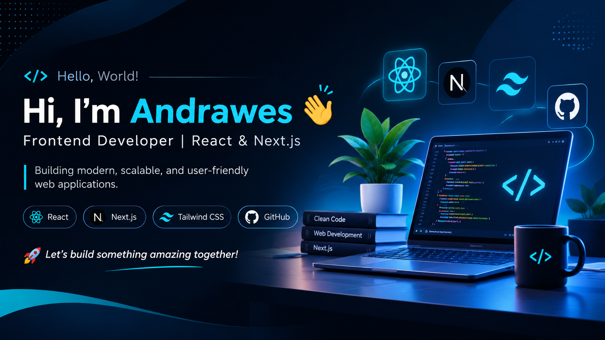

  

<h3 align="center">
  Frontend Developer | React & Next.js
</h3>

  Building modern, scalable, and user-friendly web applications.

  
  
  

# Hi, I'm Andrawes 👋

### Frontend Developer | React & Next.js

I'm passionate about building modern, responsive,
and user-friendly web applications.

## 🚀 About Me

- 💻 Frontend Developer
- ⚛️ Working with React and Next.js
- 🎨 Interested in UI/UX and clean design
- 🌱 Always learning new technologies

## 🛠️ Tech Stack

- HTML5
- CSS3
- JavaScript
- TypeScript
- React
- Next.js
- Tailwind CSS
- Git & GitHub

<h2 align="left">🛠️ Languages and Tools</h2>

  
  &nbsp;&nbsp;&nbsp;
  
  &nbsp;&nbsp;&nbsp;
  
  &nbsp;&nbsp;&nbsp;
  
  &nbsp;&nbsp;&nbsp;
  
  &nbsp;&nbsp;&nbsp;
  
  &nbsp;&nbsp;&nbsp;
  

  
  &nbsp;&nbsp;&nbsp;
  
  &nbsp;&nbsp;&nbsp;
  

